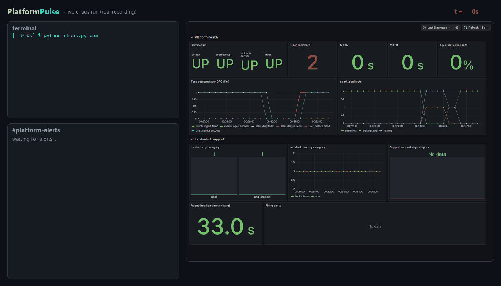
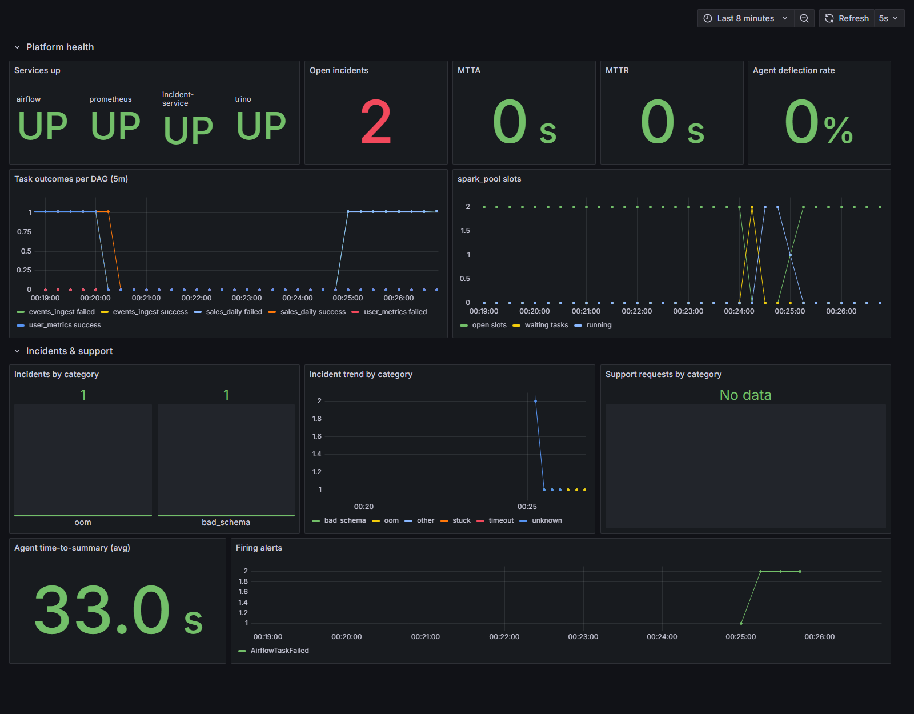
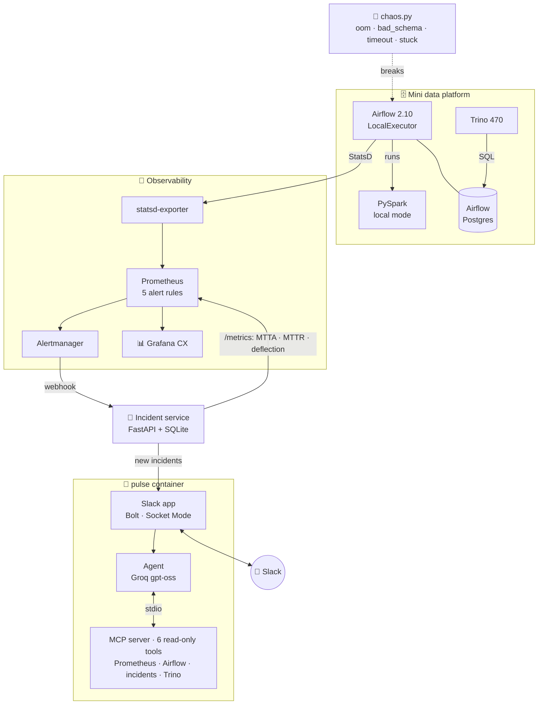

<a id="top"></a>
<p align="center">
  
</p>

<p align="center">
  <b>Break a data platform on purpose. Watch an AI agent detect, triage and explain it in Slack.</b><br>
  <sub>Airflow + PySpark + Trino · Prometheus / Alertmanager / Grafana · PagerDuty-style incidents · custom MCP server · Slack Bolt · ₹0 to run</sub>
</p>

<p align="center">
  
  
  
  
  
  
  
  
  
  
  <a href="LICENSE"></a>
</p>

<p align="center">
  <a href="#-results">Results</a> ·
  <a href="#-quick-start">Quick start</a> ·
  <a href="#-architecture">Architecture</a> ·
  <a href="#-the-mcp-server">MCP server</a> ·
  <a href="ARCHITECTURE.md">Deep dive</a> ·
  <a href="REVIEW_LOG.md">AI review log</a>
</p>

---

## 💡 Why

On a data platform, the support loop is always the same. A job breaks, an alert fires, and someone digs through metrics, task logs and runbooks, then posts an update in Slack and chases the incident to resolution. **PlatformPulse rebuilds that loop at laptop scale and hands the digging to an agent.**

You run a small data platform, break it in one of four realistic ways, and watch it work:

1. 🔥 **Detect.** Airflow metrics flow through StatsD into Prometheus, and an alert rule fires.
2. 🚨 **Open.** Alertmanager sends a webhook to a PagerDuty-style incident service (open → ack → resolve).
3. 🤖 **Triage.** An LLM agent calls **its own MCP server** to read DAG state, task logs, metrics and runbooks, then classifies the failure.
4. 💬 **Explain.** The diagnosis lands in the incident's Slack thread with evidence, a next step and the matching runbook.
5. 📊 **Measure.** Grafana shows platform health, MTTA/MTTR and how often the agent resolved things without a human.

<p align="center">
  <br>
  <sub>A real, unedited run: <code>chaos.py oom</code> → alert at t+80s → posted to Slack → agent classifies <code>oom</code> in 24s, with Grafana updating live.<br>Frames were captured automatically from the running stack, and the thread text is the agent's actual output.</sub>
</p>

## 📑 Table of contents

- [Results](#-results)
- [Features](#-features)
- [Architecture](#-architecture)
- [Quick start](#-quick-start)
- [Break it on purpose](#-break-it-on-purpose)
- [The MCP server](#-the-mcp-server)
- [Slack experience](#-slack-experience)
- [Project structure](#-project-structure)
- [Engineering notes](#-engineering-notes)
- [Docs](#-docs)

## 📈 Results

Measured, not estimated. [`pulse/eval.py`](pulse/eval.py) runs the full loop for every case: inject the failure → the alert fires → an incident opens → the agent triages it. Raw rows: [`eval/results.csv`](eval/results.csv).

| Failure type | Model | Runs | Accuracy | Median detect | Median time-to-summary | p90 time-to-summary |
|---|---|:-:|:-:|:-:|:-:|:-:|
| 💥 OOM | `gpt-oss-120b` | 4 | **100%** | 28.4 s | 27.5 s | 34.7 s |
| 🧩 Bad schema | `gpt-oss-120b` | 4 | **100%** | 26.7 s | 19.4 s | 30.0 s |
| ⏱️ Timeout | `gpt-oss-120b` | 4 | **100%** | 107.8 s | 8.1 s | 8.5 s |
| 🧊 Stuck DAG | `gpt-oss-20b` | 5 | **80%** | 46.1 s | 57.4 s | 147.7 s |
| **All** | mixed | **17** | **94%** | 40.6 s | 19.4 s | 34.7 s |

<details>
<summary><b>How to read these numbers (and what's excluded)</b></summary>

- **Detect** is the time from injecting the failure to the incident row. For timeout it includes the job's 90 s `execution_timeout` by design.
- **Time-to-summary** is how long the agent takes to triage once the incident is open.
- `gpt-oss-120b`'s Groq free tier allows 200k tokens a day, and it ran out mid-eval. The stuck runs therefore used `gpt-oss-20b`, and the model is recorded on every row.
- One stuck run crashed inside the agent and is counted as a miss.
- Three stuck runs recorded under an eval-harness bug (the pool was restored *before* triage) are excluded. They're kept in [`eval/stuck_runs_invalid.csv`](eval/stuck_runs_invalid.csv), and the bug is explained in [REVIEW_LOG #9](REVIEW_LOG.md).
- Eval incidents are resolved as `eval` and never count toward the dashboard's deflection rate.

</details>

## ✨ Features

| | |
|---|---|
| 🧪 **Chaos on demand** | `chaos.py` injects a Spark **OOM**, a **schema mismatch**, a **task timeout**, or a **stuck DAG** (a 0-slot pool) |
| 🔭 **Observability as code** | StatsD mapping, 5 Prometheus rules, an Alertmanager webhook, and a Grafana dashboard JSON, all provisioned on `up` |
| 🚨 **PagerDuty-style incidents** | FastAPI + SQLite: dedupe on fingerprint + start time, open → ack → resolve, `resolved_by=agent\|human` |
| 🧰 **Custom MCP server** | 6 read-only tools over 4 backends: Prometheus, the Airflow REST API, the incident DB, and Trino |
| 🤖 **Tool-calling agent** | MCP stdio client + Groq, strict JSON output, retries on 429 and malformed tool calls |
| 📚 **Runbook search** | 12 runbooks, embedded locally with fastembed (`bge-small`), no API cost |
| 💬 **Slack app** | Alerts with buttons, an auto-triage thread, `/pulse`, @mention Q&A with Solved / Escalate, and an App Home tab |
| 📊 **CX metrics** | MTTA, MTTR, agent time-to-summary, support requests by category, and **deflection rate** |
| 🪶 **Laptop-sized** | One `docker compose up`, about 5.8 GB of memory caps, about 2.2 GB idle, ₹0 to run |

<p align="center">
  <br>
  <sub>The provisioned Grafana "Customer Experience" dashboard: platform health, task outcomes, pool slots, incidents, support and agent latency.</sub>
</p>

## 🏗 Architecture



<details>
<summary><b>Services, ports and memory budget</b></summary>

| Service | Role | Port | Mem cap |
|---|---|---|---|
| airflow | `standalone`, LocalExecutor, JDK 17 + PySpark | 8080 | 2.5 GB |
| trino | SQL over `tpch` + the Airflow metadata DB, 1 GB heap | 8081 | 1.5 GB |
| postgres | Airflow metadata | – | 256 MB |
| statsd-exporter | StatsD → Prometheus | 9102 | 64 MB |
| prometheus | 5 s scrapes, alert rules | 9090 | 300 MB |
| alertmanager | webhook to the incident service | 9093 | 64 MB |
| incident | incident lifecycle + `/metrics` | 8000 | 128 MB |
| grafana | provisioned dashboard | 3000 | 256 MB |
| pulse | Slack app + agent + MCP server + eval | – | 768 MB |

The design decisions are written up in [ARCHITECTURE.md](ARCHITECTURE.md) and [DESIGN.md](DESIGN.md).
</details>

## 🚀 Quick start

**You need** Docker Desktop (8 GB for WSL2/VM), a free [Groq](https://console.groq.com) API key, and a free Slack workspace.

```bash
git clone https://github.com/Vaibhav2824/PlatformPulse.git && cd PlatformPulse
cp .env.example .env            # add GROQ_API_KEY, SLACK_BOT_TOKEN, SLACK_APP_TOKEN
docker compose up -d --build
```

| Open | URL |
|---|---|
| Grafana CX dashboard | http://localhost:3000 |
| Airflow (`admin` / `admin`, dev only) | http://localhost:8080 |
| Prometheus alerts | http://localhost:9090/alerts |
| Incident API docs | http://localhost:8000/docs |

<details>
<summary><b>Setting up the Slack app (5 minutes)</b></summary>

1. Go to [api.slack.com/apps](https://api.slack.com/apps) → **Create New App** → **From a manifest**, choose YAML, and paste [`slack_manifest.yml`](slack_manifest.yml).
2. Under **Basic Information → App-Level Tokens**, generate a token with `connections:write` and put it in `SLACK_APP_TOKEN` (`xapp-…`).
3. Under **Install App**, install the app to your workspace and put the bot token in `SLACK_BOT_TOKEN` (`xoxb-…`).
4. Create a public `#platform-alerts` channel and run `/invite @PlatformPulse`.
5. Run `docker compose up -d pulse`.

Socket Mode means you don't need a public URL or tunnel.
</details>

## 🧪 Break it on purpose

```bash
python chaos.py oom          # Spark driver Java heap OOM              → sales_daily
python chaos.py bad_schema   # renamed input columns → AnalysisException → events_ingest
python chaos.py timeout      # job hangs → AirflowTaskTimeout          → user_metrics
python chaos.py stuck        # spark_pool set to 0 slots → task never starts
python chaos.py restore      # put the pool back
```

Within about 30 s an alert fires, an incident opens, Slack gets the alert with **Ack · Summarize · Runbook · Resolve** buttons, and the agent posts its diagnosis in the thread.

To reproduce the eval yourself (it uses a lot of Groq tokens):
```bash
docker compose run --rm --no-deps pulse python eval.py 5
```

## 🧰 The MCP server

[`pulse/mcp_server.py`](pulse/mcp_server.py) is a standard **stdio MCP server** built with FastMCP. Every tool is read-only.

| Tool | Backend | What the agent uses it for |
|---|---|---|
| `get_dag_status` | Airflow REST | latest runs, task states, try numbers, **pool slots** |
| `get_task_logs` | Airflow REST | error lines + the log tail (the evidence) |
| `query_prometheus` | Prometheus | live metrics, firing alerts |
| `get_incidents` | Incident service | open/recent incidents |
| `search_runbooks` | fastembed (local) | semantic search over 12 runbooks |
| `run_trino_query` | Trino → Airflow DB | run history via SQL (single `SELECT/SHOW/DESCRIBE/EXPLAIN/WITH` only, 50-row cap) |

Any MCP client can use it, including Claude Desktop:
```json
{ "mcpServers": { "platformpulse": {
    "command": "docker",
    "args": ["compose", "-f", "<repo>/docker-compose.yml", "run", "--rm", "-i", "--no-deps", "pulse", "python", "mcp_server.py"] } } }
```

<details>
<summary><b>Example triage output (a real run)</b></summary>

```json
{
  "category": "timeout",
  "summary": "The user_metrics.run_spark task failed due to an AirflowTaskTimeout. The Spark job exceeded its execution_timeout and the subprocess was killed, so the run was marked FAILED.",
  "evidence": ["{timeout.py:68} ERROR - Process timed out, PID: 1360",
               "airflow.exceptions.AirflowTaskTimeout: Timeout, PID: 1360"],
  "runbook": "rb-task-timeout",
  "next_step": "Check upstream source latency; if the runtime is expected, raise execution_timeout and add retries with backoff.",
  "tools_used": ["get_dag_status", "get_task_logs", "search_runbooks"]
}
```
</details>

## 💬 Slack experience

| Surface | What it does |
|---|---|
| 🚨 **Alert post** | severity, alert, DAG/task, incident # and status, with **Ack · Summarize · Runbook · Resolve (agent) · Resolve (human)** buttons |
| 🧵 **Auto-triage thread** | category, summary, evidence, next step, runbook id and agent latency |
| `/pulse` | service health, task failures in the last hour, MTTA/MTTR, deflection, open incidents |
| `@PlatformPulse …` | Q&A backed by live tools, with **Solved ✅ / Escalate 🙋** buttons that feed the deflection rate |
| 🏠 **App Home** | the same health view, refreshed whenever the tab is opened |

## 🗂 Project structure

```
PlatformPulse/
├── airflow/              # Dockerfile (slim + JDK17 + PySpark), 3 DAGs, Spark job with chaos hooks
├── observability/        # statsd mapping, prometheus.yml, 5 alert rules, alertmanager.yml
├── incident_service/     # FastAPI + SQLite incident lifecycle, /metrics, pytest suite
├── pulse/
│   ├── mcp_server.py     # 6-tool MCP server
│   ├── agent.py          # Groq tool-calling loop over MCP stdio
│   ├── slack_app.py      # Bolt app: alerts, buttons, /pulse, @mention, App Home
│   ├── eval.py           # chaos → incident → triage benchmark
│   └── runbooks/         # 12 markdown runbooks
├── grafana/              # provisioning + customer_experience.json
├── trino/                # 1 GB heap, tpch + postgresql catalogs
├── notebooks/            # postmortem analysis of eval + incidents
├── eval/                 # results.csv, results.md
├── chaos.py              # stdlib-only failure injector
└── docker-compose.yml
```

## 🛠 Engineering notes

This was built with **Claude Code** in a 5-hour sprint, with every AI mistake reviewed and logged. [REVIEW_LOG.md](REVIEW_LOG.md) has 10 entries. Some of the ones that mattered:

- 🔕 **An alert that never fired.** `airflow_pool_starving_tasks` stays at 0 for a truly stuck (0-slot) pool, yet it fired on normal contention. It was replaced with "tasks waiting and none running".
- 📏 **An eval that measured a healed system.** The harness restored the pool before the agent triaged, so those runs were excluded and the harness was fixed.
- 📉 **Test traffic in business KPIs.** Eval runs had inflated "deflection" to 95%. Eval incidents are now resolved as `eval` and filtered out by a SQL view.
- 🪦 **A retired model.** The default LLM had been retired by the provider, so the model is now chosen from the live model list.

Other choices: the agent is **read-only by design** (it recommends and humans remediate), every image and package version is pinned, and the incident service has a `pytest` suite (`docker compose run --rm incident pytest`).

## 📚 Docs

| Doc | What's in it |
|---|---|
| [PRD.md](PRD.md) | problem, users, goals, success metrics, JD-gap mapping |
| [ARCHITECTURE.md](ARCHITECTURE.md) | components, data flow, memory budget, design rationale |
| [DESIGN.md](DESIGN.md) | metrics, alert rules, DB schema, API, MCP contracts, Slack UX |
| [RULES.md](RULES.md) | sprint working agreement |
| [TASK.md](TASK.md) | phase-gated build checklist |
| [REVIEW_LOG.md](REVIEW_LOG.md) | every correction made to AI-generated code |
| [SLIDES.md](SLIDES.md) | 5-slide team presentation (Marp) |
| [notebooks/postmortem.ipynb](notebooks/postmortem.ipynb) | postmortem analysis |

---

<p align="center">
  Built by <a href="https://github.com/Vaibhav2824">@Vaibhav2824</a> · <a href="LICENSE">MIT License</a> · <a href="#top">↑ back to top</a>
</p>
